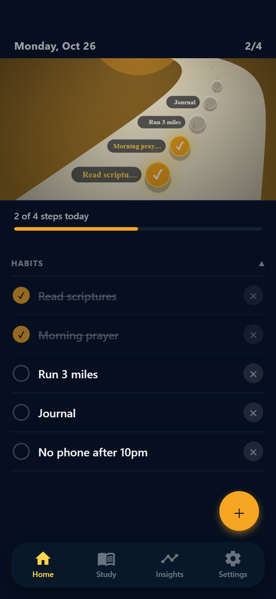
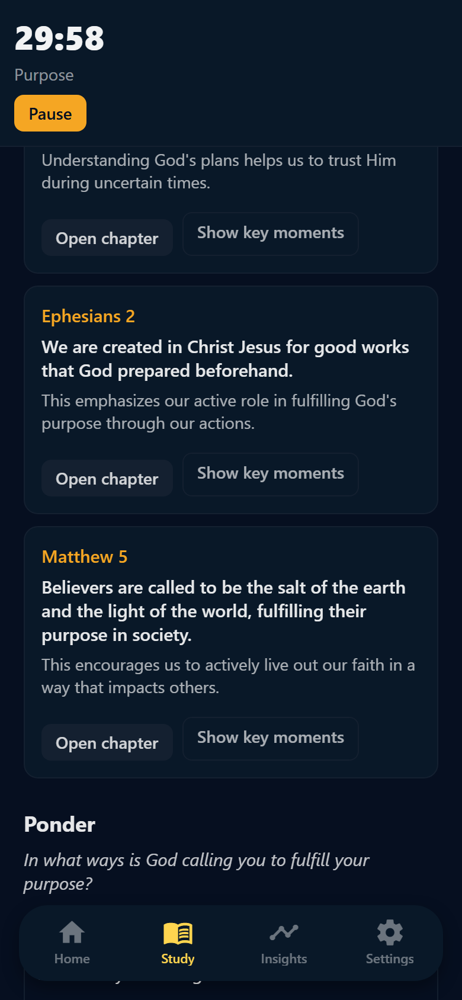
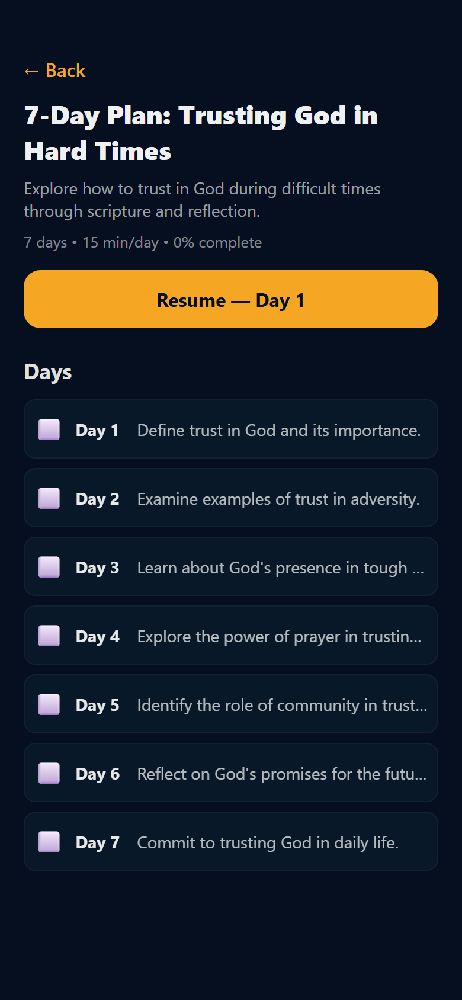
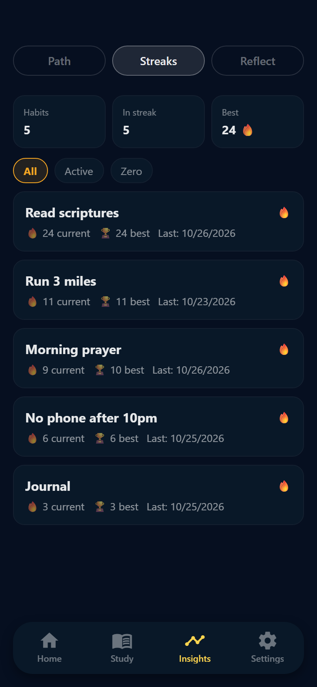
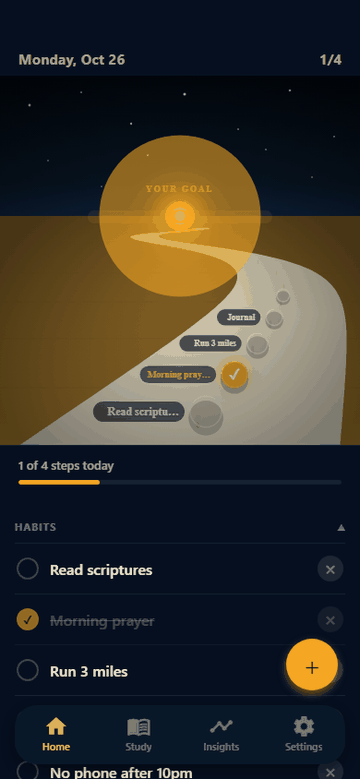

# Intentional

**A habit tracker and AI-guided scripture study app built with React Native and Expo.**

Intentional helps people build daily habits and keep a consistent study practice. It tracks streaks, generates personalized study sessions and multi-day reading plans with an LLM, and turns a week of habit data into a written reflection.

<p align="center">
  
  
  
  
</p>

<!-- Demo: replace with a GIF or video link -->
<!--  -->

## Features

- **Habits and streaks:** daily habits or habits on specific weekdays, one-tap check-off, and current/best streaks that skip unscheduled days instead of breaking.
- **AI study sessions:** pick a length (15/30/60 min), a topic and a mode (devotional, deep, challenge), and get scriptures with background, cross-references and reflection prompts. A built-in timer tracks the session.
- **Ask a question:** a chat grounded in the current session's passages.
- **Multi-day study plans:** generate a reading plan on a topic. Each day has its own focus, timer, journal and chat.
- **Journal:** entries per chapter and per plan day, with autosave and pinned prompts.
- **Weekly reflection:** an AI summary of the week based on completed habits, goals and values.
- **Faith tradition setting:** tailors content (for example, LDS users also get General Conference talks).
- **Light and dark themes.**

## Tech stack

| Layer | Tools |
| --- | --- |
| App | React Native 0.81, Expo SDK 54, TypeScript (strict), expo-router (file-based routing), Reanimated, react-native-svg |
| Storage | AsyncStorage (local-first, no account required) |
| API | Vercel serverless functions (Node, ESM) |
| AI | OpenAI `gpt-4o-mini` with JSON-mode responses |
| Quality | ESLint, `tsc --noEmit`, Vitest |

## Architecture

```
┌──────────────────────────┐        HTTPS/JSON        ┌───────────────────────┐        ┌────────┐
│  Expo app (iOS/Android/  │ ───────────────────────▶ │  Vercel functions     │ ─────▶ │ OpenAI │
│  web)                    │                          │  /api/study/*         │        └────────┘
│                          │ ◀─────────────────────── │  /api/study-chat      │
│  src/ai/apiClient.ts     │   validated, normalized  │  /api/reflection/*    │
│        │                 │   JSON                   │  per-IP rate limiting │
│        ▼                 │                          └───────────────────────┘
│  AsyncStorage            │
│  habits · logs · journal │
│  AI response cache       │
└──────────────────────────┘
```

- **Local-first:** all user data (habits, logs, journal entries, plans) lives on the device. The backend has no database and stores nothing.
- **Single API client:** every network call goes through `src/ai/apiClient.ts`, which builds URLs, applies a 45s timeout with `AbortController`, and normalizes responses before they reach the UI.
- **The API key never ships in the app.** The client only knows the API URL; the OpenAI key exists only in the server environment.

## Engineering notes

**Caching AI output.** Generated study content is cached in AsyncStorage under a key built from the normalized chapter list, the study depth and a `promptVersion`. Reopening a chapter is instant and free, and bumping the prompt version invalidates stale results without a migration.

**Defensive parsing of model output.** The functions request JSON mode, then validate and normalize the shape on both server and client. Missing arrays become empty arrays, and URLs (such as links to conference talks) are generated server-side instead of trusting model-written links.

**Streak logic.** `computeStreak` walks day by day from the first completion to today, so weekday-only habits don't lose their streak on days off. Tests caught a timezone bug here: `new Date("2026-10-26")` parses as *UTC* midnight, which is the previous evening in US timezones, so today's check-off never counted. Date keys are now parsed as local dates (`parseDateKey`), and the test suite runs in `America/Denver` so the bug can't come back silently.

**Protecting a public endpoint.** The API has no user accounts, so each function applies a per-IP fixed-window rate limit (`api/_lib/rateLimit.js`). OpenAI spending is also capped at the account level.

## Project structure

```
app/                 Screens (expo-router)
  (tabs)/            Home, Study, Insights, Settings
  habits/[id].tsx    Habit detail + streak history
  study/             Journal, study plans, per-day plan view
src/
  ai/apiClient.ts    All backend calls, timeouts, caching
  core/              Shared types, date helpers, storage wrappers
  habits/            Habit CRUD and streak calculations (+ tests)
  study/             Sessions, journal and plan storage
components/          Shared UI (themed components, progress bar)
api/                 Vercel serverless backend
```

## Running locally

Requires Node 20+.

```bash
npm install
cp .env.example .env      # set EXPO_PUBLIC_API_URL
npm start                 # then press i / a / w for iOS, Android or web
```

To run the API yourself, deploy the repo to Vercel with an `OPENAI_API_KEY` environment variable (see [DEPLOY.md](DEPLOY.md)). If the API is unreachable, the app falls back to a built-in sample study plan.

```bash
npm test             # unit tests (Vitest)
npm run lint
npm run typecheck
```

## Roadmap

- Optional cloud sync so data survives reinstalling the app
- Habit reminders with local notifications
- Shared rate limiting (Redis) instead of per-instance memory
- More test coverage for the study plan and journal storage
